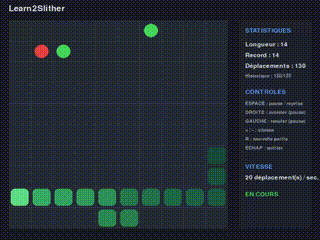

# Learn2Slither 🐍

Un jeu Snake intelligent qui apprend à jouer de manière autonome grâce au Reinforcement Learning (Q-learning).



## Présentation

Learn2Slither est un projet de Reinforcement Learning dans lequel un agent apprend à jouer au Snake par essais et erreurs.

À chaque déplacement, l'agent observe son environnement, choisit une action et reçoit une récompense en fonction du résultat. Au fil des parties, il améliore progressivement sa stratégie pour collecter les pommes et éviter les collisions.

Le projet utilise le **Q-learning** avec une Q-table pour mémoriser les meilleures actions à effectuer dans chaque situation.

## Fonctionnalités

- Environnement Snake avec pommes vertes et rouges.
- Agent autonome basé sur le Q-learning.
- Vision limitée aux quatre directions autour de la tête du serpent.
- Exploration et exploitation pour apprendre progressivement.
- Détection et pénalisation des comportements répétitifs.
- Sauvegarde et chargement des modèles entraînés.
- Mode évaluation sans modification du modèle.
- Interface graphique avec pause, vitesse configurable et navigation dans l'historique.
- Plateaux de dimensions variables, sans réentraînement du modèle.

## Installation

Cloner le dépôt :

```bash
git clone git@github.com:gregoiregobert/learn2slither.git
cd learn2slither
```

Créer un environnement virtuel :

```bash
python3 -m venv .venv
source .venv/bin/activate
```

Installer les dépendances :

```bash
pip install -r requirements.txt
```

## Utilisation

### Entraînement

Entraîner un agent sur 5 000 parties :

```bash
python main.py -episodes 5000 -model models/model_5000.json
```

Le modèle est sauvegardé au format JSON dans le dossier `models/`.

### Évaluation

Évaluer un modèle sur 100 parties :

```bash
python main.py -evaluate 100 -model models/model_5000_anti_loop.json
```

L'évaluation mesure notamment :
- La longueur moyenne maximale du serpent.
- La meilleure longueur atteinte.
- Le nombre moyen de déplacements.
- Le taux de réussite (longueur d'au moins 10).

L'évaluation ne modifie pas le modèle.

### Interface graphique

Lancer une partie avec un modèle entraîné :

```bash
python main.py -dontlearn -model models/model_5000_anti_loop.json -gui
```

Définir la vitesse de jeu :

```bash
python main.py -dontlearn -model models/model_5000_anti_loop.json -gui -speed 30
```

Commandes de l'interface :

| Touche | Action |
|---|---|
| Espace | Pause / Reprise |
| Flèche droite | Avancer d'un déplacement (en pause) |
| Flèche gauche | Reculer dans l'historique (en pause) |
| + / - | Modifier la vitesse |
| R | Nouvelle partie |
| Échap | Quitter |

### Modifier la taille du plateau

Le modèle peut être utilisé sur différentes dimensions de plateau :

```bash
python main.py -dontlearn -model models/model_5000_anti_loop.json -gui -width 20 -height 20
```

Les dimensions peuvent être modifiées sans réentraîner l'agent.

## Fonctionnement du Q-learning

Le Q-learning est un algorithme de Reinforcement Learning qui apprend à associer une valeur à chaque action possible dans une situation donnée.

L'agent utilise trois éléments principaux :

- **État :** représentation de la vision du serpent dans les quatre directions.
- **Action :** déplacement vers le haut, le bas, la gauche ou la droite.
- **Récompense :** valeur positive ou négative attribuée selon le résultat de l'action.

L'agent utilise une stratégie d'exploration et d'exploitation :
- Exploration : essayer de nouvelles actions pour découvrir de meilleures stratégies.
- Exploitation : choisir les actions qui ont déjà donné les meilleurs résultats.

La Q-table conserve les valeurs apprises pour chaque état et chaque action.

## Structure du projet

```text
Learn2Slither/
├── main.py
├── models/
│   ├── model_1.json
│   ├── model_10.json
│   ├── model_100.json
│   └── model_5000_anti_loop.json
├── src/
│   ├── agent/
│   │   ├── actions.py
│   │   ├── q_learning.py
│   │   └── state.py
│   ├── environment/
│   │   ├── board.py
│   │   ├── game.py
│   │   └── snake.py
│   ├── training/
│   │   ├── rewards.py
│   │   └── trainer.py
│   ├── utils/
│   │   └── arguments.py
│   └── visualization/
│       ├── interface.py
│       └── renderer.py
└── requirements.txt
```

## Technologies

- Python
- Pygame
- Reinforcement Learning
- Q-learning
- JSON

## Auteur

Projet réalisé dans le cadre du cursus de l'École 42.